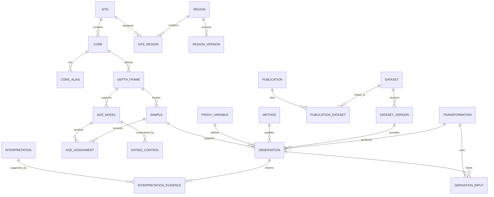

# Arquitectura propuesta — versión de diseño 0.1

Este documento es una especificación; no describe una base de producción desplegada. La extracción de prueba es una tabla larga CSV/JSON. El esquema es global: el Mediterráneo es una región analítica inicial, definida por geometrías/versiones de región y no codificada en las claves. Para la versión de plataforma, ver también [`arquitectura_plataforma.md`](arquitectura_plataforma.md) y [`source_connectors.md`](source_connectors.md).

La tesis identifica casos de validación marinos: ODP Sites 976/977 (icnología/ORLs) y GP03PC (multiproxy). Su extensión a lagos, registros fluviales, polen, árboles, espeleotemas o hielo se realiza mediante valores controlados de ámbito y tipo de archivo; no se añaden columnas marinas a esos archivos continentales.

## Relaciones principales



Las conexiones modelo–control y transformación–salida pueden ser muchos a muchos en una implementación general; usar tablas puente cuando un control se reutilice o un procesamiento produzca varios conjuntos. Un sitio puede tener varios sondeos. Un composite puede utilizar varios testigos, por lo que requiere `composite_member` además de este diagrama simplificado.

## Entidades y campos mínimos

| Entidad | Identidad, campos y restricciones |
|---|---|
| `publication` | UUID, DOI normalizado único cuando exista; título, autores ordenados/ORCID, revista, año de artículo, versión, corrección/retractación; prueba de revisión por pares; cuartil con sistema/año/categoría, nullable |
| `site` | UUID, nombre, ámbito/archivo, geometría WGS84 EPSG:4326, coordenadas originales/CRS, precisión y fuente; elevación terrestre y profundidad de agua separadas con datum/unidad originales |
| `region`, `region_version`, `site_region` | Región configurable y asignación versionada de sitios a geometrías con fuente/fecha; cuenca, polígono de estudio, ecozona o región terrestre; nunca clave ni filtro global fijo |
| `core` | UUID, sitio, campaña, plataforma, dispositivo, recovery y penetration separados; identificador externo/IGSN si existe |
| `core_alias` | Nombre original, fuente y relación validada con `core`; un alias sin contexto no es clave global |
| `depth_frame` | `mbsf`, `mcd`, sección/local u otro; unidad, datum, corrección y referencia; estado validado/ambiguo |
| `composite_member` | Testigo y tramo, marco de entrada/salida, ecuación/offset, incertidumbre y versión; no sumar offsets tácitos |
| `sample` | UUID, marco, top/bottom, profundidad puntual si procede, unidad original, identificador del laboratorio, soporte/volumen, fracción y preservación; distinguir muestra puntual de intervalo |
| `dataset` | UUID, repositorio, DOI u otro identificador, título, creadores, relación colección/hijo; distinto de publicación |
| `dataset_version` | UUID, dataset padre, versión/repositorio, fecha de publicación/registro/acceso separadas, URL, archivo, SHA-256, licencia y permiso; objetos originales inmutables |
| `publication_dataset` | Publicación, conjunto, tipo de relación (`supplement`, `related`, `reuse`, `collection`) y prueba de la relación |
| `proxy_variable` | UUID, etiqueta original y canónica, familia, analito/taxón/material, magnitud, unidad y escala nominal/ordinal/continua; objetivo ambiental separado |
| `method` | Instrumento, protocolo, tratamiento, fracción, estándares, límite de detección/cuantificación, calibración y cita; parámetros versionados |
| `observation` | UUID, muestra, variable, método, versión de conjunto, réplica, valor numérico o categórico, texto original, cualificador `<`/`>`, unidad original y canónica, error/tipo/nivel, estado QC, localizador fila/columna/página; valor nulo requiere razón explícita |
| `dating_control` | Material/taxón, profundidad y marco, fecha 14C sin calibrar y error/laboratorio, tefra/U-Th/tie point, curva/versión, ΔR/error y convención, fecha calibrada/distribución; conservar cada etapa |
| `age_model` | Testigo/marco, nombre, versión, método/software, parámetros, controles/prior, discontinuidades, referencia temporal, curva/reservorio, independencia y dependencias del tuning; estado publicado/recalculado |
| `age_assignment` | Modelo + muestra/profundidad, edad mediana/central y tipo de resumen, unidad/base temporal, límites/probabilidad o referencia a ensamble; múltiples modelos por muestra permitidos |
| `transformation` | UUID, descripción, fórmula, entradas, parámetros y unidades, versión de script/commit y entorno, fecha, responsable, incertidumbre/propagación; grafo acíclico |
| `derivation_input` | Resultado/transformación y cada entrada, papel y versión exacta; no guardar solo una lista de DOI |
| `interpretation` | Autor, publicación, afirmación, variable ambiental, lugar/intervalo, método y nivel de confianza atribuido; separar interpretación fuente de la del atlas |
| `interpretation_evidence` | Interpretación + observación/conjunto, sentido apoyo/contradicción y justificación |
| `qc_issue` | Entidad/campo afectado, regla, gravedad, evidencia, decisión, revisor y estado; no borrar alertas resueltas, guardar resolución |
| `asset` | Imágenes, cortes, escalas, área y resolución, licencia y checksum; trazas/índices enlazados a área y observador |

## Icnología y micropaleontología

Extensiones `taxonomy_name`, `taxon_mapping`, `assemblage_count` y `ichnology_assessment` conservan nombres originales, revisión taxonómica, lista y denominador, fracción de tamiz, recuentos, escala de bioturbación y definición, observador, área/volumen, incertidumbre y recurso gráfico. La ausencia observada requiere un esfuerzo/método definido. Un campo vacío significa desconocido, no ausencia.

No mezclar abundancia absoluta, proporción, flujo y número de individuos. La escala ordinal de bioturbación conserva sus categorías; una media aritmética requiere justificar el modelo que la hace interpretable. Las transformaciones porcentuales y las tasas de acumulación necesitan sus denominadores, densidad seca y sedimentación cuando corresponda.

## Tiempo y cronología

- Campo de interfaz `sample_age_ka_bp`: miles de años antes de 1950, con `time_scale` (`calendar`, `radiocarbon`, `relative`, `unknown`) y `age_model_id`. Un número 14C no se vuelve edad calendario por dividir entre mil.
- `publication_year_ce`: año de publicación del artículo principal, no de la muestra, DOI, depósito o acceso.
- `dataset_published_at`, `doi_registered_at`, `accessed_at_utc`: fechas separadas.
- Conservar valores BP negativos cuando estén publicados. No usar `age >= 0` como restricción universal.
- Filtros de edad: límites inclusivos y numeración de joven a antiguo; rechazar rangos invertidos. En una búsqueda por cobertura: `record_min <= query_max AND record_max >= query_min`; en la gráfica: filtrar las edades de cada valor. La cobertura no prueba continuidad.
- Ensambles: Parquet/NetCDF/Zarr según volumen, ejes explícitos `(age_model, draw, depth)`, unidades, semilla y dependencias. No guardar solo bandas si se pretende propagar incertidumbre temporal.
- Unir por profundidad solo entre marcos compatibles y validados. No ajustar una cronología con el mismo proxy que se utiliza después para demostrar fase sin declarar circularidad.

## Control y trazabilidad

`status` separa `unreviewed`, `source_verified`, `method_reviewed`, `harmonized_validated`, `quarantined`. Verificar el DOI no certifica el método. Licencia desconocida permite catalogar metadatos conforme a sus condiciones, pero no autoriza redistribuir el contenido numérico o imágenes.

Los controles son dimensionales y semánticos: integridad referencial, coordenadas, rango y unidad, duplicados, censura, monotonía/hiatus, taxonomía y método. Los posibles outliers se señalan; no se eliminan sin regla y decisión registrada. Los valores publicados y las versiones armonizadas se consultan por separado.

La tabla larga de prueba no sustituye este diseño. Sus campos `age_model_id=archived:<dataset>` son identificadores de procedencia provisionales, no modelos de edad auditados. `dataset_citation_year` es solo el año de la cita del conjunto; no pretende sustituir la fecha de depósito.

## Estructura de carpetas

```text
mediterranean-multiproxy-atlas/
  README.md
  CONTRIBUTING.md
  CITATION.cff
  config/seed.json                 # columnas y decisiones de selección explícitas
  config/sources.json              # alcance, API, estado y límites de cada proveedor
  thesis_source/                   # tesis recibida + hash/manifest; referencia, no instrucciones
  data/
    raw/pangaea/                  # bytes originales TSV + página HTML
    provenance/downloads.json     # URL, acceso, SHA-256 y tipo de contenido
    processed/                    # catálogo y observaciones de prueba CSV/JSON
    interim/                      # futuro: extracción revisable antes de normalizar
    harmonized/                   # futuro: resultados derivados, nunca sobre raw
  docs/
    arquitectura_datos.md
    arquitectura_plataforma.md
    source_connectors.md
    revision_tesis.md
    fuentes_y_busquedas.md
    dictionaries/                 # futuro: variables, unidades, taxones y marcos
    decisions/                    # futuro: resoluciones y cambios de esquema
  scripts/                        # descarga, extracción, figuras y empaquetado
  src/seed_query.py               # filtros puros de prueba
  tests/                          # integridad y semántica de filtros
  figures/                        # SVG maestros y PNG de inspección
  reports/                        # informe, auditoría y entorno
  manuscript/                     # borradores de artículo científico, claramente versionados
  report-app/                     # visor local del informe; no es el atlas
  notebooks/                      # futuro: análisis exploratorio documentado
  app/                            # futuro: interfaz del atlas, aún no creada
  api/                            # futuro: API, si se justifica
  releases/                       # futuro: manifiestos y versiones archivadas
```

Las carpetas marcadas “futuro” son una propuesta y no se han creado con datos vacíos. No duplicar datos en notebooks o en el frontend; las salidas consumen la misma selección y manifiesto de procedencia. Versionar código, configuración y documentación; archivar conjuntos grandes por versión y hash con licencia. Un futuro paquete reproducible debe poder reconstruir desde originales preservados, incluso si el proveedor deja de responder.
