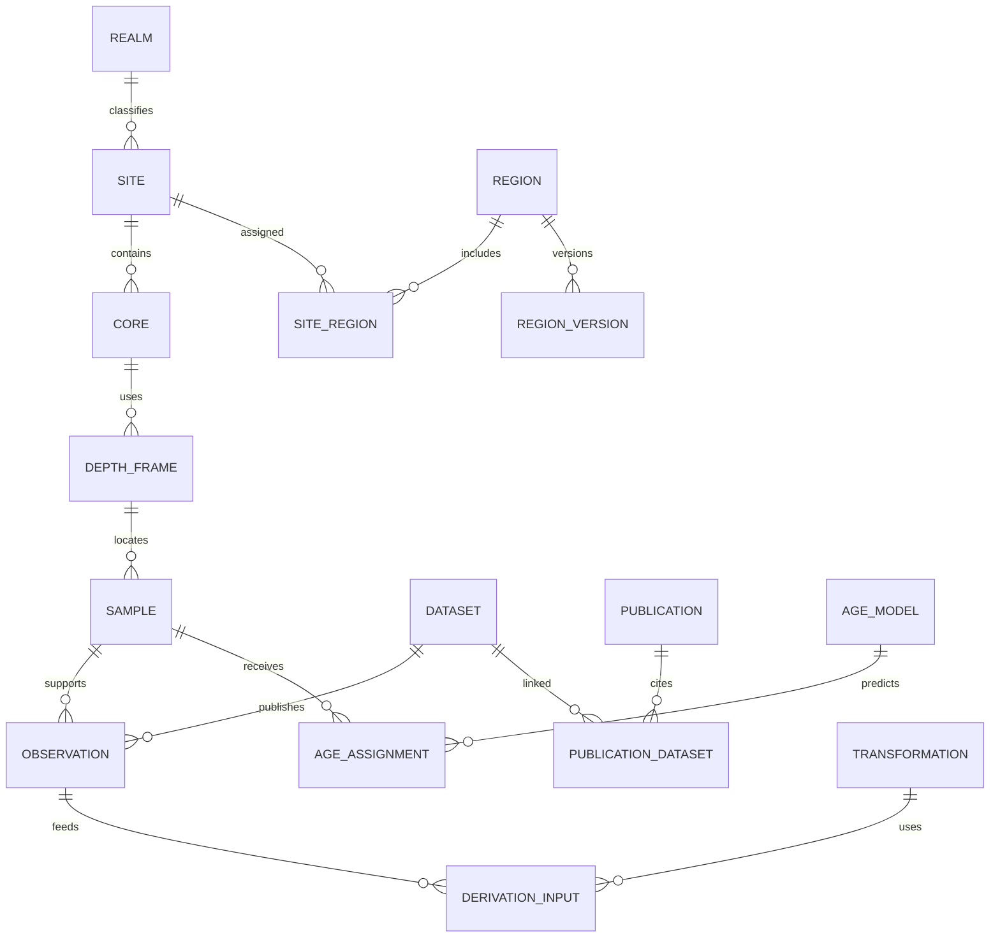

# Plataforma global y extensible

## Principios

El Mediterráneo es el primer caso de uso, no una restricción del esquema. Cada registro pertenece a una región versionada mediante una relación muchos-a-muchos entre el sitio y unidades geográficas; agregar una nueva zona no requiere alterar el modelo ni desplegar una base distinta. La forma espacial principal es el punto medido por la fuente, acompañado de precisión/CRS y, cuando se publique, una geometría de sitio. Una versión de límites define la pertenencia a cuenca, subcuenca o región analítica.

La unidad física central continúa siendo el sitio/testigo y su contexto deposicional. `realm` permite separar marino, lacustre, fluvial, terrestre, espeleotema, hielo y otros; `archive_type` detalla el tipo de archivo y `water_depth_m` y `elevation_m` son campos distintos. Así se incorporan lagos y cuevas sin fingir que son sondeos marinos. La escala taxonómica, los modelos de edad, el soporte de muestra y las licencias siguen siendo específicos de la fuente.

Los conectores son adaptadores solo de lectura. Devuelven una carga nativa, una URL resoluble y evidencia de acceso; la normalización queda en un paso separado y versionado. El adaptador no debe borrar nombres/códigos originales ni recalcular edades. La política inicial no escribe datos a los repositorios fuente.

## Capas

1. **Catálogo de fuentes:** identidad, API/descarga, cobertura, términos, limitaciones y estado del adaptador en `config/sources.json`.
2. **Clientes de adquisición:** PANGAEA, NOAA WDS, Neotoma, DataCite y lector LiPD; límites de paginación, peticiones y errores explícitos.
3. **Área de aterrizaje inmutable:** bytes recibidos en `data/raw/<source>/<sha256>.*`; manifiesto con URL solicitada/final, fecha de acceso, MIME, DOI, hash y licencia.
4. **Zona intermedia:** parsers por esquema que mantienen claves y unidades originales; nunca descartar campos no reconocidos.
5. **Modelo normalizado:** publicación, conjunto, sitio, testigo, muestra, observación, proxy, método, cronología, transformación, interpretación y jurisdicción/área.
6. **Vista de consulta:** índice/consultas por región, coordenadas, ámbito, tiempo de muestra, publicación, proxy y calidad de procedencia.
7. **Aplicación científica:** mapa, filtros, gráficas temporales, ficha de evidencia y exportaciones tabulares/SVG.

El proyecto empieza con ficheros y Python/SQLite para evitar operar una base de datos prematuramente. Un volumen colaborativo pasa a PostgreSQL/PostGIS cuando el volumen de fuentes, usuarios o consultas lo requiera. La interfaz depende de una API estable y del modelo canónico, no de un conector específico.

## Modelo de sitio y región

`region` puede representar Mediterráneo, mar de Alborán, cuenca alpina, lago, país o polígono analítico; `region_version` fija geometría y fecha/fuente. Una misma serie puede aparecer en más de una unidad espacial. El núcleo no asume un polígono Mediterráneo universal ni usa país como sustituto de cuenca.

## Contrato de un adaptador

- Consulta solo endpoints documentados o una descarga identificada por DOI/ID.
- Mantiene límites de página y ofrece el enlace de continuación de la fuente.
- Devuelve registros nativos y metadatos de recuperación; no inventa campos faltantes.
- Preserva código de sitio, evento, dataset, DOI, publicación, vocabulario de proxy, licencia y respuesta original.
- Separa edad de muestra, año de artículo, fecha de depósito y fecha de acceso.
- Indica qué está implementado: descubrimiento, metadata, descarga, extracción y/o normalización.
- Distingue falta de registro, error del servicio, acceso restringido y licencia desconocida.
- Usa límites de descarga, reintentos con espera, timeout y `User-Agent` identificable.

## Cobertura del primer paso de conectividad

| Fuente | Tipo de archivo | Acceso inicial | Cobertura del primer adaptador |
|---|---|---|---|
| PANGAEA | Marino y también fuentes ambientales continentales | OAI-PMH, DOI/content negotiation, TSV | Datos/metadata por DOI y harvest de metadatos; no búsqueda interna no documentada |
| NOAA WDS Paleoclimatology | Marino, terrestre, lacustre, hielo, corales, espeleotemas | JSON con paginación, preview y descargas | Búsqueda y preview; la descarga debe respetar restricciones por editor |
| Neotoma | Principalmente terrestre/lacustre/paleoecología | REST JSON v2: sitios, conjuntos, cronologías y descargas | Búsqueda y acceso a conjunto nativo; no reinterpretar taxonomía/modelos |
| DataCite | Global, multidisciplinario | REST DOI search/metadata | Descubrimiento interrepositorio y desduplicación; no observaciones |
| LiPD | Varios dominios | Paquete local `.lpd` | Inspección/lectura de metadatos y tablas; validar versión del estándar |
| PaleoMED20, WPA/PaleoDataView, WDB-Paleo, SISAL | Catálogos/reconstrucciones/colecciones | Descargas u otras interfaces sujetas a cada versión | Registrados como fuentes por integrar; no se afirma conexión activa |

## Ruta de crecimiento

**Etapa 1:** reproducir seed mediterránea y levantar inventarios de fuente; conectar una muestra de Neotoma y NOAA, además de sus archivos, con archivos originales y manifest. **Etapa 2:** importar LiPD/SISAL y reconciliar DOI/site aliases/chronologies; comparar las coberturas de PaleoMED20 y el atlas global. **Etapa 3:** implementar almacén relacional y catálogo global con políticas de licencia/versionado. **Etapa 4:** extender la aplicación desde su API a nuevas regiones y dominios sin cambios en las tablas centrales.

